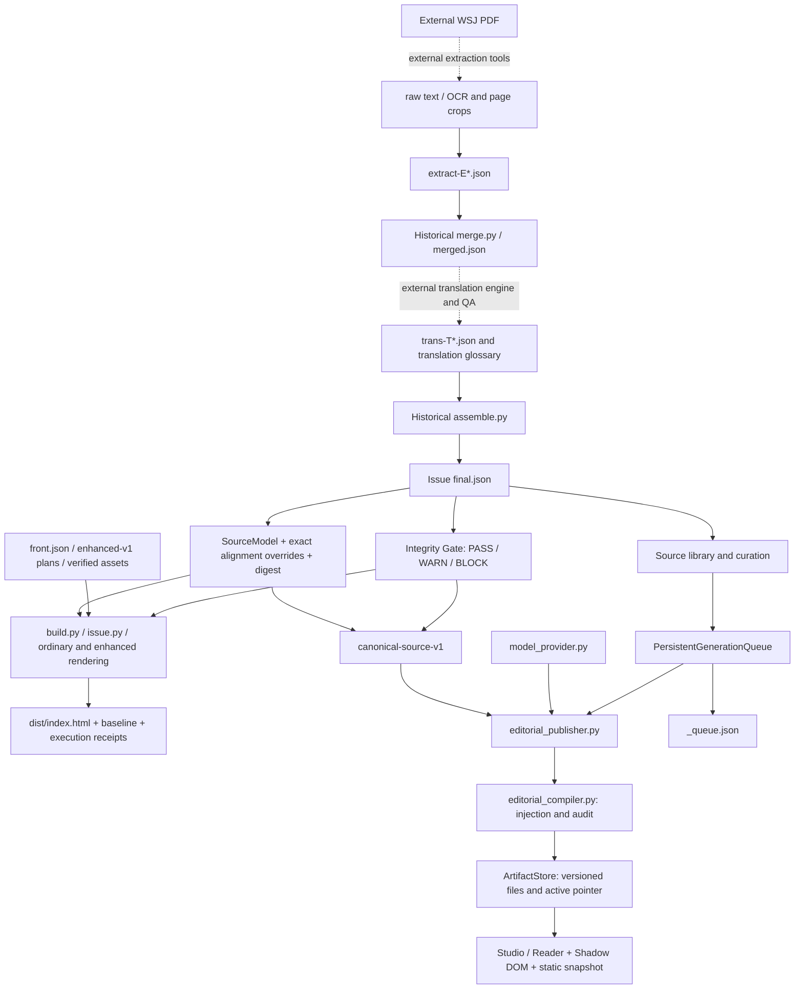

# WSJ 深读 · Architecture

Current implementation reviewed on 2026-10-14. This describes the preserved Phase 1–7 implementation and the local governance checkpoint. Product invariants live in [FOUNDATION](FOUNDATION.md); execution commands live in [BUILD](render/BUILD.md).

## Actual data flow



Dashed edges require tools/services outside this repository. There is no single working PDF-to-Reader command. The source PDF is absent. The issue-local translation adapters refer to external `translate-gemma.py` and old machine paths. Current tests begin from preserved `final.json`; they do not certify OCR or translation accuracy.

## Production modules

Entry points: `render/build.py` (whole issue), `render/editorial_studio.py` (Studio, Reader, queue), `render/integrity_gate.py` (`make gate`) and `scripts/smoke.py` (isolated acceptance). Every other module is reached from those, and nothing else is an entry point. All names in the table below are under `render/`; the suites live in `tests/`. Modules remain colocated to preserve script imports and verified behavior; a package migration is not required for current usage.

| Module | Actual responsibility and inputs |
|---|---|
| `integrity_gate.py`, `declutter.py` | Detect unconfirmed continuation, truncation markers and extraction defects. Return findings without changing copy. WARN requires editorial disposition; it is not PASS. |
| `source_model.py` | Shared bilingual paragraph projection; exact English repair records; content digest over article fields and alignment repair. Preserve unmatched tails rather than silently truncate. |
| `canonical_builder.py` | Build `canonical-source-v1`: metadata, ordered `pN` blocks, lossless sentence anchors, quote/metric candidates and media. Attach candidate provenance diagnostics; date labels follow the selected issue. |
| `claim_provenance.py` | Source/claim-bound evidence records, literal quotation and numeric checks, Decimal calculations and host semantic dispositions. Inventories authored interventions as one review unit each (SVG/figure/aside/table/section/`data-claim`), gates numbers, quotations, charts, candidates and presentation code, and leaves loose typography inventoried without gating. See [Claim Provenance](docs/claim-provenance.md). |
| `build.py`, `issue.py` | Deterministic whole-issue CLI, front selection, gate filtering, type-aware composition and validation receipts. Does not invoke a model or load ArtifactStore. |
| `article.py`, `components.py` | Ordinary type rendering, metadata, copy, figures and data appendix. |
| `enhanced_render.py`, `text_treatment.py`, `layout.py` | Execute `enhanced-v1` plans against source anchors, exact text and digest; reject unsupported/stale operations with receipts. Empty intervention retains ordinary rendering. |
| `editorial_publisher.py` | Generation prompt, provider call, strict compilation, one targeted repair retry by default, and verified/failed persistence. Also imports already generated raw HTML. |
| `model_provider.py` | Callable, OpenAI-compatible and Anthropic adapters; model inventory and external credential resolution. Returns output and usage metadata. |
| `editorial_compiler.py` | Deterministically inject canonical text into `data-ref`, populate `data-derive`, check coverage/order/exact text, enforce Claim Provenance, sanitize some markup/CSS, adapt styles to Shadow DOM, diagnose SVG bounds. |
| `artifact_store.py` | Preserve raw HTML, compiled HTML and complete metadata per version; require a passing current claim gate and matching compiled/Shadow delivery digests for new versions. Preserve historical reopening, index, active pointer, failed attempts and browser metrics. |
| `generation_queue.py` | Discover issue directories, calculate curation tiers, enforce admission and WARN confirmation, persist tasks, deduplicate pending/running work, recover and execute serially. |
| `editorial_studio.py` | Local threaded HTTP host, source library, version selection, canonical inspector, queue controls and static Reader export. Python and the inline client currently share one file. |
| `tracer/` (`vector.py`, `numbers.py`, `verify.py`, `charts.py`, `compose.py`, `content.py`, `shell.py`, `routing.py`, `whatsnews.py`, `gate.py`, `full_compose.py`), `tracer_pipeline.py` | Vertical Tracer (Tickets 1–2 / ADR 0001): compiles the 2026-10-14 issue into a single-file Issue Artifact from primary PDF vector signals. Union chart re-crops via `fitz`+WebP, `<wsj-chart>` SVG primitives with `data-src="pK"` numeric grounding, natural `after pK` figure anchoring from print-order coordinates, genre-aware Tier 2 composition, composite columns, AST surgical completion and forbidden-chrome assertions. Ticket 2 scales it to the full 86-item issue: `routing.py` maps all 28 raw section strings onto the 7 canonical sections with rubric kickers and routes items into three tiers with zero silent fallback; `whatsnews.py` resolves the 16 digest bullets to full articles (entity/keyword/number overlap) and renders deep-link badges; `gate.py` is the two-stage LQA funnel (deterministic five-invariant radar over all 1,257 bilingual units in <0.5s, then targeted disposition into a workspace-side `gate-report.json` that never enters the reader HTML); `full_compose.py` builds all ~71 reading units including the five Composite Columns, the standalone brief/caption, view-only market-table pages and bilingual Chart Companions for all 21 printed charts. `fitz`/`PIL` are lazy imports so the pure core runs in any interpreter with `lxml`. CLI: `tracer_pipeline.py --mode full` (default) / `--mode tracer` (five-unit pilot slice) / `--units id,...` subset runs, with `--output` and `--gate-report`. Acceptance: `tests/test_vertical_tracer.py`, `tests/test_full_issue_gate_cli.py`. |

`tokens.css` and `editorial.css` serve the static renderer. Generated article styling comes from the publishing prompt and saved artifacts. `DESIGN.md` records the accepted static baseline and historical experiments; the publishing prompt currently has a different palette/font prescription. Unifying those design contracts is a product/design decision, not an automatic governance restyle.

## Source and publishing contracts

- `final.json` is the QA-approved bilingual source. OCR, drafts and article bodies remain immutable during formatting. Repair overrides create an auditable projection; they do not rewrite the source file.
- `pN` means paragraph position in a particular source projection, not a globally stable paragraph identity. A changed source/repair digest invalidates an anchored static plan. Sentence subdivision is used only when joining preserves both original locales.
- Whole-issue publishing excludes curation removals and hides WARN/BLOCK entries behind review anchors. Its source library and its visible newspaper are different sets.
- Queue admission rejects BLOCK and requires explicit WARN confirmation. Curation recommends long features versus restrained briefs and excludes some non-narrative types. The legacy `/api/generate` route and CLI `--enqueue` currently imply WARN confirmation; use Studio batch confirmation for deliberate review.
- Publisher itself checks BLOCK. A direct caller of the publishing/import functions must provide the editorial decision about WARN; those functions do not share a persistent review-disposition record.
- Compiler verification proves referenced narrative copy coverage, order and exactness. New strict compilation also requires source-bound evidence and host dispositions for active derived/editorial additions. Literal/numeric/calculation checks cannot certify attribution, semantic entailment or chart encoding; those remain host review responsibilities. Historical compiler PASS records retain their original meaning and are not retrospectively fact-approved. Browser metrics have a separate `pending_browser_check` state; compiler success alone is not visual approval. See [Claim Provenance](docs/claim-provenance.md).
- The two output families are separate contracts. `index.html` is the whole newspaper. `editorial-reader.html` contains generated article versions. `enhanced-v1` plans are not the generated HTML protocol.

## Persistence and runtime

```text
<issue>/editorial-artifacts/
  _index.json                 Article/version registry and active version
  _queue.json                 Durable task records and restart state
  <article-id>/
    canonical.json            Most recently saved canonical snapshot
    latest.json               Active verified artifact record
    vN/
      artifact.json           Model/usage/digest/audit + Shadow DOM bundle
      raw.html                Original model output
      compiled.html           Deterministically injected standalone output
    failed-N/                 Failed output and failure report
```

Verified versions coexist. A new failed generation leaves the previous active artifact readable. `canonical.json` is overwritten by subsequent attempts; it is not a per-version frozen source archive. Each version retains its source digest and injected compiled text.

Queue states are `pending → running → completed/failed`, with cancellation and retry. Deduplication is currently `(article_id, model_id, content_digest)` across pending/running tasks. Provider and custom instructions are not part of that key. Queue JSON is written by temporary-file replacement; invalid JSON or a non-list task collection now fails explicitly and remains untouched.

On startup, tasks left running are matched to a recently saved active artifact by timestamp, otherwise returned to pending. Studio automatically resumes pending work. Recovery is a useful heuristic, not an exact transaction/task identity guarantee. Cancellation marks a task; it does not interrupt an in-flight provider request, and the generated artifact can still be persisted.

The queue lock is process-local. Artifact JSON/index/pointers still use direct writes; version allocation and promotion are not a multi-file transaction. Run one Studio writer per checkout/issue. Concurrent processes or interruption during store writes can leave inconsistent metadata. Stop writers before backup; preserve the entire artifact tree and queue together. Follow [data policy](docs/data-policy.md) before recovery.

## Experiments and legacy code

Archived material stays intact because it is primary evidence. None of it is a production entry point:

- `experiments/phase5-exp01/`: original free-HTML versus source-anchor experiment, independent compiler/schema, golden baseline, three runs and screenshots. No production import depends on its compiler.
- `archive/render-experiments/`: historical planner, plan-contract and layout drivers (`autonomous_planner.py`, `plan_adapter.py`, `plan_validate.py`, `plan_render.py`, `orchestrate.py`, `run_auto_test.py`, `run_blind5.py`, `pipeline.py`, `build_prototype.py`, `build_layout_test.py`, `build_layout_configs.py`, `build_test_pages.py`, `build_reboot_four.py`, `turn_page.py`). `pipeline.py` runs the integrity stage and prints the rest; `build_reboot_four.py` cuts a proof strip. None is a resumable daily orchestrator. See [archive/README.md](archive/README.md).
- `2026-10-12/archive/legacy-scripts/`: earlier issue builders (`build_html.py`, `build_v2.py`–`build_v6.py`), source assembly (`merge.py`, `assemble.py`, `trans-T*.py`, `seed_glossary.py`) and the case builders. Rerunning assembly overwrites the current final source; that is a content migration, not a routine step.
- `2026-10-12/archive/experiments/`: `gen-test/`, `cases/`, `ovis-test/` — extraction and layout experiments, each pairing its own builders with results, some with old absolute paths. `cases/assets/` and `ovis-test/visual-assets/` are now historical: the referenced images live in the issue `assets/`.
- `2026-10-12/archive/historical-outputs/`: generated pages, screenshots, stage artifacts and deliveries — `test-pages/`, `auto-test/`, `layout-test/`, `blind5/`, `reboot-proof/`, `convergence-before/`, `review-evidence/`, `stages/`, the interior prototype archive and the pre-October-13 `final.json` backup.
- `2026-10-12/archive/pre-reboot-html/`: the pre-reboot hand-built newspaper versions.
- The issue root keeps only what production consumes: approved source and translation provenance, `assets/`, `editorial-plans/`, `editorial-artifacts/`, and `editorial-explorations/` (the labelled reading-rhythm plans used as the `build.py --plans-dir` example), plus `dist/`.

Dated reports and their evidence live under [docs/history](docs/history/README.md), which also records where each bundle moved from. Links were repaired when the bundles moved.

## Remaining risks before broader usage

| Concern | Evidence / next bounded decision |
|---|---|
| Second real issue | Discovery and date metadata support multiple dates, but `build.py` CLI still asserts 117 inputs and global `curation.json`, `images.json`, `alignment_overrides.json`, asset registry and `CURATED_DERIVATIONS` reuse issue-local IDs. Scope those records by issue before calling the system daily-ready. |
| Artifact/source staleness | Studio treats stored versions as generated without comparing their digest to the current source. Keep old versions readable, but show source drift before silently treating them as current. |
| Store crash/concurrency | Direct JSON writes, promotion order and `len(versions)+1` allocation need a bounded transactional persistence design before multiple writers. |
| Recovery/cancellation | Timestamp-only restart matching and post-cancellation publication need explicit task/version association if stronger guarantees are required. |
| Local API security | HTTP host binds loopback, with no authentication/origin policy, broad issue-directory static serving and mutating endpoints. Do not expose it as a shared/public service. |
| Generated HTML | Sanitizer permits short scripts, some external references and styles; Shadow DOM isolates styles, not privileges. A complete allowlist/CSP or sandbox policy needs an explicit compatibility review of generated standalone interactions. |
| Editorial factuality | Experiment 0 adds a source-bound claim gate to new compiler/store publication. Existing historical versions remain unassessed under that contract. Host review must assess semantics/attribution/graphics; existing Studio/queue have no evidence-review interface. Calibrate review before broader rollout. |
| Reader maintainability | Large embedded client in `editorial_studio.py`; extract only after pinning its actual interactions and static-export contract. Avoid a package/framework migration as incidental cleanup. |
| Upstream reproducibility | Restore the source PDF and documented extraction/translation tool versions before a fresh issue. Historical reports do not establish current model deployment. |

The current scope is local usage of preserved, tested Phase 1–7 behavior. No storage transaction, package migration, upstream engine replacement or visual redesign was performed during governance.
