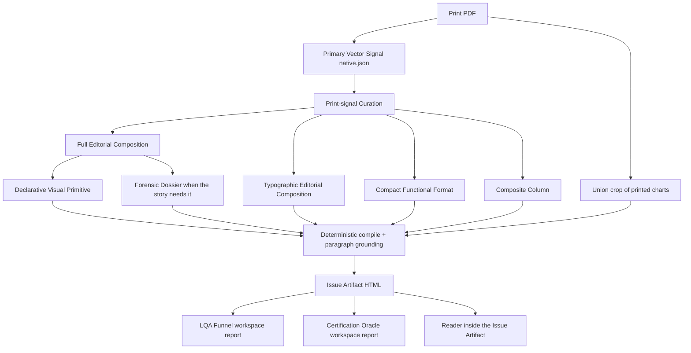

# WSJ 深读 · Architecture

Current product reviewed on 2026-10-16 against Issues #1–#5 and [ADR 0001](docs/adr/0001-three-tier-editorial-composition.md), [ADR 0002](docs/adr/0002-issue-artifact-only-product.md). Product invariants live in [FOUNDATION](FOUNDATION.md); visual tokens in [DESIGN](DESIGN.md); commands in [BUILD](render/BUILD.md).

The daily product is one portable Issue Artifact compiled from Primary Vector Signals. The Studio methodology is not a current path. Frozen runnable leftovers live on git branch `archive/studio-phase1-7`. Dated evidence: [historical index](docs/history/README.md).

## Actual data flow

Dashed nothing: this path does not call a Studio server, a persistent queue, or an external evidence sidecar. The 2026-10-14 pilot still reads inventory, reviewed translations and vector streams from the pinned `PILOT_ROOT` in `render/tracer/compose.py`, plus the original print PDF (`PDF_PATH`, `PDF_SHA256`). Those paths sit outside this repository. There is not yet a second-date runner that produces a new `native.json` from an arbitrary PDF.

## Production modules

Entry points: `render/tracer_pipeline.py` (`make tracer`, `make tracer-certify`) and `scripts/smoke.py`. Everything under `render/tracer/` is reached from the pipeline. All names below are under `render/` unless noted; suites live in `tests/`.

| Module | Actual responsibility |
|---|---|
| `tracer/vector.py` | Primary Vector Signals: font-role taxonomy, `Retina*` chart titles/sources, union crop locked to the chart column, WebP encode. |
| `tracer/routing.py` | Print-signal Curation: 28 raw section strings → 7 canonical sections, rubric kickers, Tier 1/2/3, Composite Columns, sidebar parent links. Tier 1 is derived, not listed: a multi-page story starting on a section front is a flagship, with the business front requiring body ≥ 850 words. Verified to reproduce the 2026-10-14 eight, and to hold on the held-out 2026-10-10 front page. |
| `tracer/article_map.py`, `tracer/build_reader_cache.py` | Derived article map. The reading pass enumerates each page's reading items and, when it answers `lines`, names every line each item owns; printed rules then supply folio, jump markers both directions, section banners, the column grid and body typefaces. `regions` are exact when the reading pass supplies `lines` and geometric otherwise, and each record says which via `regions_source`; they are a draft record, never a compile input — composition reads the page column grid instead ([ADR 0004](docs/adr/0004-page-column-grid-not-story-regions.md)). An item with an exact line set also gets derived `paragraphs`: printed first-line indents, subhead size and drop caps split the lines, and each paragraph carries its page, column, bbox and line regions (ADR 0004's remaining gap). See [the reconciliation](docs/history/article-map-reconciliation-2026-10-17.md). |
| `tracer/compose.py`, `tracer/full_compose.py` | Reading-unit composition, natural `after pK` figure anchoring from print $(x, y)$, Composite Columns, Forensic Dossier hero/rail, AST surgical narrative completion. |
| `tracer/content.py` | Per-story editorial layers for the 2026-10-14 flagships (including Group C Forensic Dossier copy). |
| `tracer/charts.py` | Compile `<wsj-chart data-src="pK">` into clip-free SVG; numbers must ground in the named paragraphs. |
| `tracer/verify.py` | Paragraph-scoped numeric grounding, quote anchors, highlight density, forbidden pipeline strings, fail-fast `TracerCompilationError`. |
| `tracer/numbers.py` | Substantive number tokens and cross-language magnitude normalization. |
| `tracer/whatsnews.py` | What's News digest and 16 deep links into reading units. |
| `tracer/shell.py` | Reader shell: 7-section nav, overview / immersive views, `中文 / EN / 双语`, Issue Artifact CSS/JS. Visual authority: [DESIGN](DESIGN.md). |
| `tracer/gate.py` | LQA Funnel: Stage-1 five-invariant radar, Stage-2 spot-check; writes `gate-report.json` next to the artifact, never inside it. |
| `tracer/oracles.py` | Seven Certification Oracles over the compiled HTML; writes `oracle-certification.json` in the workspace. |
| `tracer_pipeline.py` | CLI: `--mode full` / `tracer`, `--units`, `--fast`, `--gate-report`, `--certify`. |

The 2026-10-14 full issue currently compiles to 71 reading units (8 Tier 1, 54 Tier 2, 9 Tier 3) from 86 source items, with 21 printed charts. Those counts are oracle fixtures for this issue, not a universal quota.

Studio-era modules are gone from `main`. Recover the frozen tree from git branch `archive/studio-phase1-7`. Do not reintroduce them as publication paths.

## Source and publishing contracts

- Primary Vector Signals plus the reviewed bilingual translation units are the publication source for the Issue Artifact. Formatting and compilation never rewrite narrative copy. The LQA Funnel records dispositions; it does not edit paragraphs.
- `pK` is a paragraph position in that issue's projection. Authored elements carry `data-src="pK"` (or `data-ref`). Every substantive number in an authored element must ground in the named paragraph(s), plus `Retina*` vector text for Chart Companions.
- Missing narrative anchors are inserted in the `lxml` AST. Remaining factual mismatch fails the compile. Tiers are never silently downgraded.
- Curation is print-signal routing into three tiers and Composite Columns, not a Studio admission queue.
- The Issue Artifact is the only reader delivery. LQA and Oracle JSON are workspace reports. Forbidden pipeline strings (including "gate-report", "Vertical Tracer", machine-translation banners) must not appear on the Reader surface.
- `make tracer` writes a self-contained HTML file (target 5–8 MB, budget [4.5 MB, 10 MB]). It does not write `editorial-artifacts/` or `dist/index.html`.

## Persistence and runtime

The Issue Artifact, `gate-report.json` and `oracle-certification.json` are one-shot files. Default make outputs go to `/tmp`. There is no persistent generation queue, no per-article version store, and no Studio writer lock on this path.

Pilot inputs are pinned absolute paths in `compose.py`. Changing machine layout breaks the run until those pins move. The print PDF is not in this repository; retain it outside Git per [data policy](docs/data-policy.md).

`--fast` skips PDF raster work and, under certification, skips the payload-budget check. It is a smoke mode, not a publishable Issue Artifact.

## Experiments and leftover code

Archived material stays intact because it is primary evidence. None of it is a production entry point:

- `experiments/phase5-exp01/`: original free-HTML versus source-anchor experiment.
- `archive/render-experiments/`: historical planner and layout drivers. See [archive/README.md](archive/README.md).
- `2026-10-12/`: the Studio-era issue tree (source, plans, editorial-artifacts, dist). Evidence, not a daily runner.
- `docs/history/`: dated investigations, including the superseded [claim provenance contract](docs/history/claim-provenance.md).
- Frozen Studio-era Python: git branch `archive/studio-phase1-7`.

Dated reports live under [docs/history](docs/history/README.md).

## Remaining risks

| Concern | Evidence / next bounded decision |
|---|---|
| Second real issue | Routing is no longer tabulated for 2026-10-14 — Tier 1 is derived from print signals and reproduces the reference eight, holding on the held-out front page. Still calibrated to one issue: oracles carry `EXPECTED_TIERS`/unit counts/21 charts/16 deep links, and the composite columns and section map are the reference issue's. A new date needs a new inventory, translations, `native.json` and oracle fixtures. |
| Pinned external inputs | `PILOT_ROOT` and `PDF_PATH` are absolute paths outside this repo. The pipeline is not portable until those pins become issue-local, documented inputs. |
| Upstream reproducibility | A fresh PDF still has no in-repo hop that emits `native.json` and reviewed bilingual units. The 2026-10-15 pipeline probe recorded PARTIAL/BLOCKED extraction hops on the old chain; that probe does not certify the vector path either. |
| Model-authored layers | Flagship copy in `tracer/content.py` (including Forensic Dossier) is issue-specific. Daily Full Editorial Composition still needs a bounded model seam that emits primitives and dossier grammar without reviving Studio generation. |
| DESIGN vs leftover CSS | Issue Artifact tokens live in `tracer/shell.py`. `reference/hybrid-v3/` is the superseded static baseline. |
| Untracked compile debris | `wsj-2026-10-14.html` and `blobs/` are leftover compile/gitoid debris, not product inputs. |
