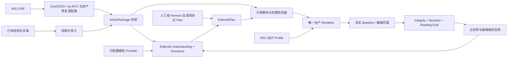

# C · Target Architecture & Governance Plan

状态：建议与处置决定；本轮未执行重构、归档、删除、提交、合并或部署。依据见 [A](A-ARCHITECTURE-AUDIT.md)，协议见 [B](B-PRODUCT-AND-CONTRACT.md)，实施门槛见 [D](D-EVALUATION-AND-MIGRATION.md)。

## 1. 架构决定

**保留 Python 和静态页面交付，收敛到一个 CLI、一个内容协议、一个编辑计划协议、一个生产 Renderer。** 模型只生成有证据的编辑数据；设计系统和 Renderer 实现排版。日常 Workflow 使用顺序任务、文件快照、完整缓存键、原子写出和可重放运行记录。

这是一项小型出版工具的工程收敛，不是 AI Publishing Platform。四层 Editorial 能力可以在同一进程、同一仓库中协作，逻辑责任不同不等于需要不同服务。

Baseline 是相同 Content、相同设计、相同正常化与来源资产政策下的空编辑方案；不是第二个 Renderer。处理 PDF 的前置适配器可停机，已缓存 ArticlePackage 仍能编辑、渲染和评测。

## 2. 简单的深模块

| 模块 | 对外必须知道什么 | 内部实现与复用 |
|---|---|---|
| Content import | 一个结构化包或 legacy final 输入；输出不可变 ArticlePackage 与输入问题 | 复用组装经验、源锚定思想、续文与对齐修复；不读取 Harness key |
| Editorial planning | ArticlePackage + policy → EditorialPlan；也接受外部保存 Plan | 一份共享 prompt/规则；Provider 参数注入；理解和选择在一次模型调用中完成，先不分成多 Agent |
| Render | ArticlePackage + 可选 Plan + WSJ profile → RenderResult | 复用 issue、article、components、tokens、T/L 实现；正文投影和 metadata 只有一个执行语义 |
| Evaluate | 固定 Benchmark + 已存内容/计划/渲染 → 三类分离结果 | 完整性 code checks、决策 rubric、人工实读；可接 Promptfoo；不触发内容重写 |
| Run | 文件输入、配置、输出目录、明确的重跑点 | 顺序调用上述模块、缓存、状态、原子产物；Cron/Agent 调同一个 CLI |

无需额外 Source API、Plan service、资产服务器、向量数据库或“通用插件平台”。先建立已经真实变化的 seam：输入方式、Planner Provider/外部 Plan；其他未来 Renderer 只在协议上可互操作，不为证明扩展提前实现第二套生产页面。

## 3. CLI 与 Harness 的实际差距

| 目标 | 当前证据 | 目标行为 |
|---|---|---|
| 本机 CLI | 静态 `build.py --issue` 已能重建一期 | 任意合法结构化文章/本期配置均能运行，不要求 117 条 |
| Pi/Codex/Claude Code | build 可被 shell 调；Planner 偷读 Pi models.json | Harness 只是调用者；配置/凭据通过显式环境或配置文件提供 |
| Personal Agent | 没有稳定 JSON 返回与错误语义 | stdout 单份机器可读结果，进度 stderr，退出码与 run manifest 一致 |
| Cron/服务器 | 没有包/依赖声明，阶段 runner 只跑 integrity | 固定运行时与工作目录无关入口，单进程顺序执行，有重入锁和失败记录 |
| Provider 更换 | endpoint/model/key 位置写死，存在两套 Planner prompt | model/base_url/credential_ref 由配置注入；核心接收同一 Plan |
| 缓存/增量 | 一部分 integrity 缓存，盲测按文件存在复用 | 按每个真实阶段的全部依赖 hash 复用，内容变更不误命中 |
| 失败恢复 | Planner 失败可变成空 Plan，HTML 在断言前写出 | failed 与 preserve 分开；失败不覆盖上一份有效产物 |
| 重新评测 | 历史 validation 文件与页面各自保存 | 对已存 Plan/HTML 重评，无需重复调用生产模型 |

建议 CLI 能力为 `import`、`plan`、`render`、`evaluate`，再提供一个调用它们的 `run`。这是目标接口名称，**不是本轮已经存在的命令**。不要沿用 `pipeline.py --from assembly` 的“打印已安排阶段”作为成功返回。

生产 `render` 不调用模型；`plan` 可配置一个兼容 chat API 的实现，或导入 Harness/人工给出的同协议 JSON。先支持已经选定的本地 Provider 及外部 Plan 文件，不提前承诺所有厂商 SDK。Provider 的差异集中在请求/响应转换和错误处理，不渗入正文、编辑语义或 CSS。

## 4. 文件工作流与恢复

### 不可变产物

每期内容包、每篇计划、RenderResult 和 eval run 分别保存，记录 input/output hash 与版本。保留原始模型响应，便于判断是模型、解析、引用还是渲染问题。不要把密钥、Authorization header 或用户私有 Harness 配置写进报告。

命令结果区分：success、failed、blocked、explicit baseline fallback。run manifest 记录 stage、article、依赖标识、输出文件、状态和错误类别；没有真实执行的阶段不得标 completed。

内容导入、计划保存和 HTML 生成先写临时文件，完成引用/正文检查后原子 rename。整期 HTML 最后一次性替换；中途失败保留上一份有效发布文件与新 run 的失败证据。

### 缓存粒度

| 阶段 | 缓存键包含 | 不应触发该阶段重算的变化 |
|---|---|---|
| Input Adapter | 源文件完整 hash、Adapter/model/参数、术语表版本（翻译时）、资产提取设置 | CSS 与 Editorial Plan |
| Content import/integrity | 完整原文/译文/metadata、对齐/修复记录、来源/资产证据、importer/checker 版本 | 纯视觉 tokens |
| Planning | content revision、prompt/规则/Schema 版本、Provider/model/参数、可用资产证据 | 同语义下的字体/边框微调 |
| Render | content revision、plan hash 或明确空 Plan、Renderer/design profile、使用资产完整 hash | Judge 模型或 rubric |
| Evaluation | Benchmark/rubric、content/Plan/RenderResult、Judge/参数、评测执行器版本 | 未涉及这些输入的日志变化 |

成功缓存必须有对应产物且 hash 验证匹配；cache hit 返回同类型结果。错误不作为正常完成缓存。实验中对相同输入的多次新采样使用独立 run ID/样本序号，不能把缓存重放当随机稳定性。

默认顺序处理文章。先避免现有 `components.ISSUE_META` 全局状态造成多期并发串写；未来出现真实吞吐问题再考虑受限并发。Cron 使用一个任务实例与普通进程锁即可；当前 macOS/Linux 可用标准 OS 文件锁，无需分布式锁/消息系统。

## 5. 技术栈决定

| 选择 | 明确需求与现有收益 | 维护成本/风险 | 决定 |
|---|---|---|---|
| Python 核心 | 已有所有正式渲染、JSON/文件/OCR 适配经验；本轮静态构建成功；stdlib 已够大部分业务 | 需补最小依赖/运行时声明、CLI 包装、类型/协议检查；不要继续无边界 dict 方言 | KEEP |
| TypeScript 重写 Engine | 未来交互编辑器可能受益；当前没有这种需求 | 重写已有 Python 逻辑、两语言维护、Node 构建、重新验证正文与 CSS | DEFER |
| 浏览器原生 HTML/CSS/少量 JS | 现有单文件页面、双语按钮、导航、details 已可用 | 字体 CDN 依赖网络；不同浏览器支持中文排版特性不同 | KEEP；定义离线 fallback 和浏览器验收范围 |
| Node/Promptfoo 作为 dev 工具 | 成熟的模型/提示批次比较、Python provider 接口、结果矩阵 | 一个锁定版本的开发依赖；评测成本仍来自数据与人工 | OPTIONAL tooling，业务核心不迁移到 TS |
| Pydantic/JSON Schema 等验证 | 一个版本协议和引用解析确有需求 | 双重 Schema 手写易漂移；引入大型验证栈仍不保证语义正确 | 选择单一规范源与轻量边界检查；不新增多层 Validator |
| 工作流平台/多 Agent Framework | 当前没有需要跨服务队列或复杂路由的证据 | 服务运维、状态分裂、模型调用更难追责 | DEFER |
| 数据库/CMS | 目前文件规模一期、计划数少，文件重放足够 | 迁移存储与管理后台没有直接阅读收益 | DEFER；只有跨用户/查询需求出现再评估 |

“不引入 npm”是当前阅读页面的设计约束，不应误读为禁止独立开发评测工具。Google Fonts 以外当前无前端运行依赖，但页面仍不是完全离线字体自包含；fallback 可运行不等于视觉一致。

## 6. 主要模块的治理决定

成本为相对工作范围，不是未经验证的工期承诺；风险列是迁移需要覆盖的真实行为。所有 ARCHIVE 建议均在迁移验收后执行，保留历史分支、代码/产物、README 索引和关键例子，本轮不删除。

| 模块/成果 | 决定 | 依据与收益 | 迁移成本 | 风险与控制 |
|---|---|---|---|---|
| `DESIGN.md / tokens.css / hybrid-v3` | KEEP | 已认可的 identity；当前实页有一致正文与头版 | 低：消除规范中的历史矛盾、版本化 | 不冻结历史数值；以真实阅读证据演进 |
| `build.py` 静态出版骨架 | KEEP | 已重建相同页面，无模型也能工作 | 中：参数/每期配置、去固定数量、原子写出 | 头版、类型分流、双语导航必须保留 |
| `issue.py` publication shell | KEEP | 当前 front 与栏目秩序可用 | 低至中：edition 输入、出版状态回执 | front 显式选稿也须符合类型资格；不能让无效 lead 混入 |
| `article.py + enhanced_render.py + plan_render.py` | CONSOLIDATE | 三套正文/组件语义；已复现 EN 丢段、零 Plan 丢 metadata | 中：先共同正文/头部，再迁旧 dispatch | 忠实 Baseline、源 heading、数据稿/图注和资产选择可能回归 |
| `components.py` 成熟 HTML 原语 | KEEP | 真实组件可复用，不必重做 | 低：统一参数、去全局 issue metadata 依赖（需并发前完成） | 重复辅助信息、英文缺字段不是样式问题 |
| `source_model.py` | SIMPLIFY | 只读/引用思想正确；运行时 pN 非稳定身份 | 中：导入持久块与 revision，搬出 caption 相似删除 | 旧 p1 标题/正文不一致；显式 legacy map |
| `alignment_overrides.json` | CONSOLIDATE | 两篇实际修复有价值，但只在增强路径执行 | 低至中：导入修复记录，保留原快照与双方完整顺序 | 合段/移除 marker 需对照来源；不得静默修改源 |
| `text_treatment.py` | SIMPLIFY | T01/T03/T06、group/subhead 可用；split/list 不在生产执行；转义坐标错误 | 中：保留有需求操作，统一 selector 与精确片段执行 | 强调错误片段、限定词被截断、范围交叉 |
| `layout.py` | KEEP | L02/L03 手机关系实际可见；L05/L08 可保留代码作为候选能力 | 低至中：语义输入，不再接受外部 HTML | L05/L08 尚无生产自主选择证明；加入支持清单需 Benchmark |
| `autonomous_planner.py + blind5 Planner` | CONSOLIDATE | 两套 prompt/模型/输出；正式未调用 | 中：同一 Plan 协议与可配置 Provider | 避免把旧 cached decision 当新模型运行；失败≠不干预 |
| `plan_adapter.py` | ARCHIVE（转换完成后） | 当前又产生 treatments/layouts 方言，key_figures 形状与生产不一致 | 低至中：一次性旧格式转换与迁移证据 | 不永久保留多个兼容分支；转换损失有明确报告 |
| `editorial-plan.schema.json` | REPLACE | 当前只覆盖旧 analysis/component_plan，生产只看 enhanced-v1 标签 | 中：按 B 建一个唯一协议源 | Schema PASS 不代表证据/干预正确；未知版本显式拒绝 |
| `integrity_gate / declutter` | KEEP（规则） | 可复用续文/截断/异常线索，本轮现有测试通过 | 中：统一输入与结果、保留 warning 语义 | regex 属于线索；不承担译文事实/全文精确一致认证 |
| `plan_validate.py` | CONSOLIDATE | 生产未调用，nested quote 探针绕过，日期/credit 仅字符串存在 | 中：并入统一 Plan 引用和事实检查 | 不能照搬旧结构；新增文字来源不能仅靠关键词查找 |
| `turn_page.py` | KEEP（Input Adapter 范围） | 续文恢复有产品必要性，核心不应依赖 PDF | 中：在源文件可取得时验证并输出修复谱系 | 当前没有真实 PDF smoke，不能称已验证提取能力 |
| `images / asset_registry / asset_coverage / curation` | CONSOLIDATE | 多清单用途不同但缺共同状态；全局文件跨期泄漏 | 中：每期资产与 publication selection，保留 verified 候选区分 | 79 文件存在≠79 图可发布；credit、误关联、图表类型需复核 |
| `modules.json` | ARCHIVE（迁移后） | 当前只有迁移注记；旧 data_ref 已不适合唯一 Plan | 低：确认遗留引用移入计划 | 不让旧 Plan 静默消失；迁移前保留原文件 |
| `pipeline.py` runner | REPLACE（小范围） | 实跑 --from assembly 仅打印；缓存 hash/返回类型错误 | 中：一个真实顺序 CLI，复用 integrity 与标准缓存思想 | 不把 stage 名称扩为平台；异常不得覆盖成品 |
| `orchestrate.py` 的 E1-025 recipe | ARCHIVE | 专属段落/选择不是通用 Engine；现有生产已有更近路径 | 低：保存案例和可用事实校验思想 | 不以“泛化这个脚本”为新编排方向 |
| `build_v* / cases builders / layout-test / gen-test builders` | ARCHIVE | 重复页面壳、Linux 路径和案例逻辑 | 低至中：保存截图/例子/原始计划及索引 | 实验内有好设计，不连同资产删除；仅停作为生产入口 |
| `build_reboot_four.py` | KEEP（证据用途） | 切正式产物的 proof，便于查看同路径输出 | 低 | 固定文章集不能代表泛化；不产生另一个 Renderer |
| `test_p1.py` 合成行为样本 | KEEP（有效样本） | 截断/门禁正反例仍有用 | 低：统一真正断言与测试入口 | `ok` 返回计数的写法经 pytest 不一定失败；CLI 与 suite 语义须一致 |
| `run_auto_test / run_blind5 / check_delivery` | ARCHIVE（吸收样本后） | 老页面/临时路径/旧文案验收，PASS 含义不一致 | 中：提取真实正反例到新 Benchmark，旧 runner 不继续充当生产 QA | 原反例与事实错误不可丢；旧 footer 要求与现行产品冲突 |
| `OPPORTUNITY_BENCHMARK / LAYOUT_DECISION_SPECS` | KEEP（知识），SIMPLIFY（形式） | 有明确拒绝条件与少量正反例 | 中：转换为带源 revision 的可运行案例 | 不沿用自评 TP/TN 结论；人审重新标注 |
| 旧 TranslateGemma / AnyDoc 等脚本 | ARCHIVE（历史输入） | 用户已选择 OvisOCR2/Hy-MT2；旧脚本依赖外部路径 | 低：保留谱系，不改写旧定稿来源 | 原有内容未必来自新模型；切换适配器不自动重译历史 |
| OvisOCR2 / Hy-MT2 adapter | KEEP（已选方向） | WSJ 前置处理选择明确，和核心分离 | 中：配置、输入缓存、输出契约 | 本轮未跑模型；上线前真实输入取证 |
| T09/T13、更多 Pattern、第二产品、多 Renderer 实现、CMS | DEFER | 有潜在价值，当前不能直接证明阅读收益 | 当前无迁移要求 | 不能让“协议可扩展”变成提前实现全部扩展 |

## 7. 合并边界与风险控制

- 首先统一生产正文与头部，保留类型分流；不要顺便把所有图像恢复、Provider、计划字段和 CSS 一起改。
- 迁旧 Plan 时记录每个引用的旧 pN、新 block_id、文本/来源 revision，检查数据形状与位置基数。`plan_render.py` after_para 使用枚举 0 基，enhanced 路径使用 pN 1 基；不能靠字段同名自动转换。
- 每期配置迁移使用当前 92 发布/21 排除/4 WARN 作为回归范围证据，但不把这些固定数写成未来产品契约。
- 合并后的所有 accepted 操作走同一执行器；实验能力未迁入则显式 unsupported。不要加兼容 alias 让旧方言继续流入生产。
- 原源数据、旧计划、实验截图与迁移前成品保存；Archive 是历史归档与入口停用，不是破坏性删除。

## 8. 决策权限与质量责任

内容导入负责保管和对齐；编辑者/Planner 负责阅读判断与新增事实证据；Renderer 负责准确执行和设计规则；评测负责人负责 Benchmark 和读者任务；出版命令负责范围与失败状态。

人审优先处理：来源不确定、新增外部事实、重大对照/图表干预、明确 WARN 与失败。低风险忠实 Baseline 和已确认内联强调可按既定 policy 自动处理，不设置对每个组件都审批的流程。

合并、部署、外部发布仍需 Jerry 批准。本轮文档不构成这些操作的授权，也没有执行这些操作。下一阶段按 D 的第一项独立改动启动，不以 Reboot 为理由重做已有效的设计。
