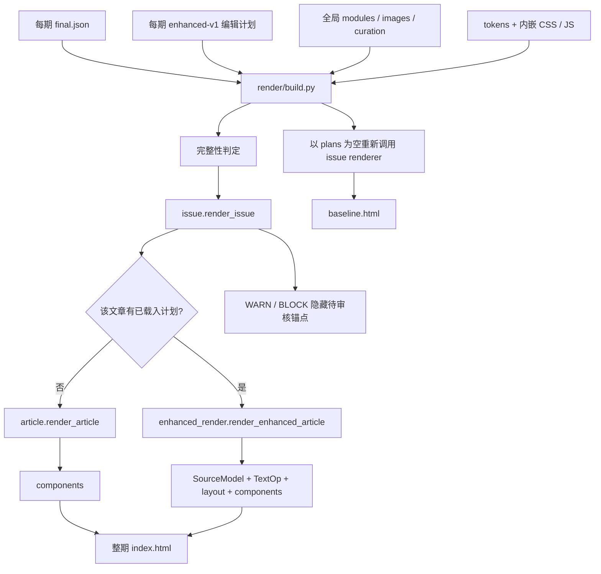

# A · Architecture Audit

审计日期：2026-10-13。范围：当前仓库、当前生产入口、实际 HTML、输入与历史实验产物。生产代码、定稿、既有页面和历史成果未修改。

配套文档：[产品与契约](B-PRODUCT-AND-CONTRACT.md)、[目标架构与治理](C-TARGET-AND-GOVERNANCE.md)、[评测与迁移](D-EVALUATION-AND-MIGRATION.md)。

## 独立判断

**需要一次有边界的收敛，不需要重写。** 现有 Python 静态出版骨架、AJ × WIRED 视觉语言和若干真实编辑决策已有价值。质量不稳定的主要原因，是内容、编辑计划与不同渲染路径没有共享同一套可执行语义；实验中的判断、验证和恢复能力也没有完整进入生产。

模型能力不足不是当前证据支持的首要解释。正式构建根本不调用 Planner。当前产品消费的是五份预先保存的人工编辑计划，未形成“通读内容 → 选择干预或不干预 → 同一渲染路径 → 与公平 Baseline 比较 → 反馈”的日常闭环。

不能继续沿用旧报告的“增强完全没有进入生产”结论：本轮实跑已确认四篇实际增强、一篇明确不干预。也不能把这些成果解释成自动生产已经完成。

## 1. 取证方法与限制

- 在临时隔离副本运行 `python3 build.py --issue 2026-10-12`，保留原仓库产物；读取当前源文件与 JSON。
- 对重建页面使用 Chromium 实页检查：1440px、390px、中文与英文切换、正文 DOM、图片加载、对照与边注。截图：[桌面头版](evidence/desktop.png)、[手机头版](evidence/mobile.png)、[手机收益率对照](evidence/compare-mobile.png)、[手机来源边注](evidence/note-mobile.png)。
- 使用临时数据及内存输入，实跑段落配对、无效锚点、未执行操作、缓存、嵌套引语验证和另一份结构化单篇输入。
- 运行现有 `python3 test_p1.py`，检查测试函数实际断言。
- 读取 Git 最近十五条提交，仅用于确认变化时间线；历史报告作为待验证主张，不作为当前事实。

当前 HEAD 的最近提交为 `46529f2`。当前文件快照 SHA-256 前 16 位：

| 文件 | 指纹 |
|---|---|
| `render/build.py` | `cc15260d66413c8f` |
| `render/enhanced_render.py` | `9315527914fd649a` |
| `render/pipeline.py` | `a11a6c6f7e9bdc28` |
| `2026-10-12/final.json` | `00fa35e8f5a9bc16` |

未运行真实 OCR、翻译或 Planner 推理。仓库没有源 PDF；配置中的本机 `127.0.0.1:18800/v1/models` 本轮连接失败（curl exit 7、HTTP 000）。这只证明本机该地址未连接成功，不证明别的机器或 Provider 不可用。未做 Safari、Firefox、第二个真实日期或读者实验。

完整的原始 Art Direction Charter 和 51 项 Pattern Catalog 未在仓库中找到；以本次任务、当前 `FOUNDATION.md`、`DESIGN.md`、已保存的设计评审及实际代码为依据。`source_model.py` 引用的 `/tmp/kit/EDITORIAL_KNOWLEDGE.md` 也不在当前可见位置。

## 2. 真正的 Production Path



入口是 [build.py](../../../render/build.py:333)，分流位于 [issue.py](../../../render/issue.py:257)。本轮成功输出：

```text
enhanced plans: ['E1-005', 'E1-010', 'E1-014', 'E2-002', 'E3-004']
gate: 113 PASS / 4 WARN / 0 BLOCK
index.html: 4884 KB, 92 articles, 5 enhanced
baseline.html: 4871 KB
assertions passed: 117 articles, 5 enhanced, paras verbatim, no duel, no pretty
```

最后一句是程序自己的日志，**不是本审计对完整性的认证**。它的段落断言只查中文前 24 字。

仓库现有页面与隔离重建页面 SHA-256 完全相同：

`b77501625564227a3cdc8822c13961e31f64277168d6b499be882456c8284864`

这证明当前页面可由当前静态入口重建；不证明上游输入正确或阅读体验优于 Baseline。

### 内容与发布范围

`final.json` 有 117 项：38 article、25 data_table、22 photo_caption、11 brief、11 opinion、6 letter、3 index_digest、1 correction。

92 项实际发布：34 article、22 photo_caption、11 brief、11 opinion、6 data_table、6 letter、1 index_digest、1 correction。另有 21 项策展排除、4 项 WARN 不进入读者正文；四个 WARN 是 E1-004、E1-007、E3-002、E3-005 的续文未确认。

[issue.py:199](../../../render/issue.py:199) 只发布无警告的 PASS。WARN/BLOCK 仅留下隐藏锚点，没有可见待审核内容，也没有持久的审核处置协议。原始 117 项仍在定稿中；发布不完整与正文被意外截断必须分开记录。

## 3. 生产、实验与历史实现

| 实现 | 当前实际角色 | 判断 |
|---|---|---|
| `build.py / issue.py` | 正式整期入口与出版壳 | 保留骨架，修复跨期配置与写出顺序 |
| `article.py` | 无增强计划的类型分流、正文、图片、数据策展 | 有用；正文语义应与增强路径合并 |
| `enhanced_render.py` | 五份 enhanced-v1 计划的生产执行器 | 已生产使用，不能再称未接入 |
| `plan_render.py` | 旧 component_plan/data_ref 渲染器 | 不在正式 build 导入链；和增强执行器重复 |
| `autonomous_planner.py` | 六段式提示与本地推理调用 | 由 auto-test 使用；正式 build 不调用 |
| `run_blind5.py` | 另一份 Planner 提示、0.2-enh 计划及专用正文渲染 | 实验；与正式输入、操作能力和 Schema 不同 |
| `orchestrate.py` | E1-025 专属 outline、treatments、去重与计划构建 | 案例实现；可提取通用思想，不应升级成生产编排器 |
| `pipeline.py` | 实际只执行 integrity，其余阶段打印名称 | 有缓存雏形，不是完整日常 Pipeline |
| `build_prototype / build_layout_test / build_layout_configs / build_test_pages` | 专用示例或测试页 | 保存实验依据，不再作为独立生产入口 |
| `build_reboot_four.py` | 从正式 HTML 切四篇 proof strip | 有证据用途，不是另一个 Engine |
| `2026-10-12/build_html.py / build_v2…v6.py / cases/build_r3*` | 旧稿及视觉实验生成器 | 历史产物；不应继续修复为可发布路径 |
| `merge.py → trans-T*.json → assemble.py` | 这一期输入的历史组装链 | 输入适配器与数据谱系，非核心编辑 Engine |
| `gen-test/pipeline.py` | 固定四篇、Hy-MT2 调用、分段与渲染实验 | 没有证明当前整期内容已经走该模型链 |

证据：[计划渲染](../../../archive/render-experiments/plan_render.py:102)、[本地 Planner](../../../archive/render-experiments/autonomous_planner.py:119)、[实验重放](../../../archive/render-experiments/run_blind5.py:407)、[单篇编排](../../../archive/render-experiments/orchestrate.py:221)、[阶段入口](../../../archive/render-experiments/pipeline.py:91)、[历史组装](../../../2026-10-12/archive/legacy-scripts/assemble.py:18)、[Hy-MT2 实验配置](../../../2026-10-12/archive/experiments/gen-test/pipeline.py:24)。

Git 记录 `f1f013a` 已把增强计划接入正式路径，之后发生了策展、头版和 Foundation 收敛。[历史 Reconstruction Brief](../PROJECT_RECONSTRUCTION_BRIEF.md) 中“117 个 article、仅一张图片、增强没进入生产”等描述不能代表当前状态；`AUDIT_MATRIX.md` 中 T/L 全未实现的描述也已过时。

## 4. 核心风险与实跑证据

| 编号 | 当前事实 | 产品影响与修复范围 |
|---|---|---|
| A01 | [components.paras](../../../render/components.py:27) 仅遍历中文段数；E2-010 有 14 段中文、16 段英文，正式 DOM 只含 14 段英文，最后两段丢失 | 双语阅读完整性失败；共享正文投影应保留双方全部内容并显式记录未对齐状态 |
| A02 | E1-014 的零操作计划走 enhanced brief 头部，佛罗里达州 dek 与 Associated Press byline 消失；普通路径保留两者 | “不干预”竟改变元数据；空计划必须等价于忠实 Baseline |
| A03 | E1-005/E2-002 的英语合段/移除 marker 只在增强路径执行，普通 Baseline 保留原始错位 | 比较同时混入内容修复与编辑效果，不能归因于编辑判断 |
| A04 | `source_from_final` 按本次段序创建 pN；≤12 中文字符且无句末标点就推断 source_head | 插入段落可使全部计划漂移；短句可被误当来源小标题。短句“预计暂不会降息”的探针确实被分类为 source_head |
| A05 | 指向 p999 的 wrap 不报错，输出 `data-enhanced="true"`，实际 strong 数量为 0 | 计划看似执行成功但没有生效；需要解析后的操作回执与未知锚点失败 |
| A06 | 生产 `render_block` 对 split 是 pass，list 不执行；T09 探针与零操作正文 markup 一致 | 实验支持能力不等于正式路径支持能力；暂不支持就显式拒绝 |
| A07 | 原文字串先 escape，再按 escape 前的坐标插入标签。`A & B 的收益率为 5.1%。` 的 T03 实际强调“益率为 ” | 内容字符串仍能相同，但编辑目标错了；在原始字符串上切片后分段 escape |
| A08 | 生产 `load_plans` 只过滤版本，没有 Schema/引用/语义校验；旧计划静默跳过 | 正式入口无法解释计划是否缺失、过期、拒绝或未执行 |
| A09 | `plan_validate` 不在生产导入链；嵌套 `data.quote` 的虚构引语探针返回 `[]` | 实验 Validator 有方言漏洞；继续增加 Validator 无法替代唯一输入契约 |
| A10 | `build.py` 写 HTML 后才检查 117；跨期图片/策展在所有文章之前预加载 | 一个失败任务可留下看似有效的成品；任意结构化输入和换期都不可靠 |
| A11 | `pipeline.py` 内容缓存键只含 ID + 中文前 100 字，英语与中文后文变化不改变键 | 错误地复用旧完整性结果；还遗漏模型、提示、设计与资产版本 |
| A12 | integrity 冷运行返回 article 结果，热运行返回 `_manifest.json` 的 `_all` | 断点恢复无法依赖一致返回类型；实际两次调用已复现 |

主要执行点：[源投影](../../../render/enhanced_render.py:62)、[生产操作分发](../../../render/enhanced_render.py:237)、[转义与坐标](../../../render/text_treatment.py:164)、[计划加载](../../../render/enhanced_render.py:24)、[嵌套引语](../../../archive/render-experiments/plan_validate.py:43)、[产物写出与断言](../../../render/build.py:425)、[缓存](../../../archive/render-experiments/pipeline.py:66)。

新结构化单篇输入的真实 CLI 实跑分两步：

1. 直接运行 `build.py --issue audit-single`：被上一期全局 curation 的 `infographic-newleft-donors.png` 路径阻断。
2. 仅在临时进程将全局 curation 设置为空：输出 1 PASS、生成 index/baseline，随后 `AssertionError: expected 117, got 1`。此时 HTML 已存在。

这不需要 OCR/PDF 就能复现，故属于 Engine 入口耦合，不能归责于 Input Adapter。

## 5. 视觉资产与来源完整性

- `asset_registry.json` 79 条均对应现存文件；其中 71 extracted、8 needs_review，全部标为 photo，关联到 46 个不同 article_id。
- `asset_coverage.json` 覆盖 117 项：45 extracted、49 no_asset、22 unrecoverable、1 needs_review。这是文章级分类，与资产条数不能相减比较。
- 正式 `images.json` 有 16 个文章映射；E3-002 被 WARN 隔离，因此实际使用其中 15 张，加 curation 的 3 张恢复图，共 18 张。Chromium 中 18 张全部加载成功。
- registry 的 79 条 credit 全为空；正式 images 的 16 条中 15 条 credit 为空。registry 示例的 `caption_cn` 实际为英语文本片段，`assoc_note` 为几何距离。

**存在文件、完成提取、正确归属、裁切完整、能承担视觉证据，是五个不同事实。** 不能直接把 79 条 registry 全自动推入出版，替代现有较窄的图片名单。应合并为一个每期资产清单，但保留显式 verified/needs_review、来源、图注、原图范围和编辑选择。

当前增强路径不会自动继承普通路径的 images/curation；目前五份生产计划没有图片，因此眼前页面没有因此损失这五篇的已选图片。风险在于未来给一个已有图片的文章添加计划，就改变资产行为。

缺失原图表的项目不能用生成摘要“恢复”。[curation](../../../render/curation.json:31) 的 suppress_body 与图表重绘必须单独记录编辑取舍；英文碎片仍在 final.json 不等于读者可以访问原证据。

## 6. Editorial Intelligence 的真实覆盖

| 尺度 | 当前生产能力 | 规则、模型和设计系统的正确责任 |
|---|---|---|
| Microtypography | 当前 CSS 的严格中文断行、角色字体、17px/1.85；摄像头稿指定标题词组 | 断行、标点、混排交浏览器与设计规则；模型仅在内容有理由时选择少量词组 |
| Editorial Typography | T01/T03/T06、T10 分组、T11 增补小标题；原始小标题启发式 | 模型判断论点、归属、边界；执行器精确应用；字重/尺度由设计统一 |
| Editorial Composition | 4 篇 L02、1 篇 L03；沙特数字/引语/时间线；恢复数据图 | 模型/编辑判断关系与位置；Renderer 保持正文顺序和手机语义；源资产必须可追溯 |
| Editorial Identity | masthead、头版主次、栏目、类型差异、色彩与字体语言已落地 | WSJ publication profile 与设计规范；无需让每篇模型重新设计品牌 |

五份生产计划均标 `created_by: Principal Engineer reboot…`，没有本轮或正式运行的模型生成记录。它们包含真实的 reader_need、叙事分析与拒绝理由；Renderer 却只消费 text_treatments/layout_decisions/component_plan/headline_phrases，分析与拒绝没有被质量评测使用。

内容理解已被**示范**，稳定自主判断尚未被**证明**。这两点必须同时承认。

## 7. Pattern Catalog 的价值与复杂性

值得保留的知识：真实同维度才比较；图形应承担证据；边注解决具体理解缺口；手机按维度 A→B；日期不可补造；保护限定词；原文已有小标题时不新增；短稿可不干预。

额外复杂性来自：T/L/A 编号被当成能力证明、四种计划方言、每条实验路径各自实现操作、无完整源文件的 51 项目录引用、单篇人工 recipe 被描述成通用判断、source_head 等结构推断放在 Renderer 内。

建议收敛成少量有正反例的“阅读问题 → 可接受选择 → 拒绝条件 → 来源证据 → 手机关系”卡片。编号可留为内部知识索引，不能成为生产协议的唯一语义。T09/T13 在需求与正确实现证明出现前不进入 MVP 支持清单。

## 8. 现有测试究竟证明了什么

| 测试/报告机制 | 实际覆盖 | 未覆盖 |
|---|---|---|
| `test_p1.py`，本轮 16 passed / 0 failed | 合成断句/重复/语言切换与 gate 的 warn/block | 没有 turn_page 调用、PDF、真实双语映射或阅读改善 |
| build 自查 | 固定条数/锚点/阅读顺序、中文前缀存在、禁止字符串、图片数量下限 | 英文全文、来源正确、全部操作执行、视觉证据正确、阅读收益 |
| `plan_validate.py` | 部分日期/引语/credit 字符串存在检查 | 同一事实归属、嵌套 quote、边注事实来源、数字单位与语气 |
| auto-test | Planner 能调用、部分事实检查、渲染泄漏与边注 DOM 顺序 | L05/L08 会被跳过；截图失败仍可设 PASS；不执行理解/查找任务 |
| blind5 | 保存/重放模型输出、操作与部分预校验、专用页面 | 缓存未绑定内容/提示；Planner 失败可退为空计划，不能当成主动不干预 |
| opportunity benchmark | 有价值的局部机会正反例文本 | 非完整可运行数据集；TP/TN 报告不等于最终页面获益 |

本轮 DOM 对比：排除独立图注标题造成的呈现项增加，所有发布的非 photo_caption 文本项中文正文序列与定稿相同；英语明确发现 E2-010 尾部丢段，以及两篇增强稿的显式合段/marker 修复。中文保留不能为英语完整性背书。

## 9. 应长期保留的设计资产

保留 `DESIGN.md` 当前阅读工艺、`tokens.css`、`reference/hybrid-v3` 的视觉语言和评审轨迹；保留头版主次与移动 DOM 顺序、640/760 栏宽关系、正文角色字体、原生折叠、颜色纪律、真实图片优先、正文连续性和有限编辑干预。

本轮截图确认头版呈现有清楚的主次层级；手机对照按三个预测区间组织，边注位于相关段落之后，原始小标题可辨识。733 个正文 p 的计算字体尺度一致，18 张图片加载正常，390px 无横向溢出。**这些是基础呈现证据，尚不是读者理解或完成阅读改善的证据。**

保存具体设计理由，避免把旧 review 的 16px/1.8 或其他历史数值重新覆盖当前 17px/1.85。排版数值需可继续在真实阅读证据下演进。

## 10. 主要复杂性来源与结论

复杂性主要集中在五个位置：同一正文多种投影；计划方言与操作能力不一致；全局文件混入每日数据；实验检查未成为生产契约；PASS 指标未接到读者任务。

推荐的改造是让这些位置收敛，而不是再加 Planner、Builder、Validator 或服务。Python 继续承担静态出版和 CLI；OCR/MT 保持可替换适配器；编辑计划保留独立数据；阅读 Benchmark 为最终质量裁决。

**第一项可实施工作：统一生产中的忠实正文投影与公平 Baseline，首先修复英文丢段和零操作计划丢元数据。** 具体范围、通过条件与之后迁移顺序见 [D](D-EVALUATION-AND-MIGRATION.md)。
