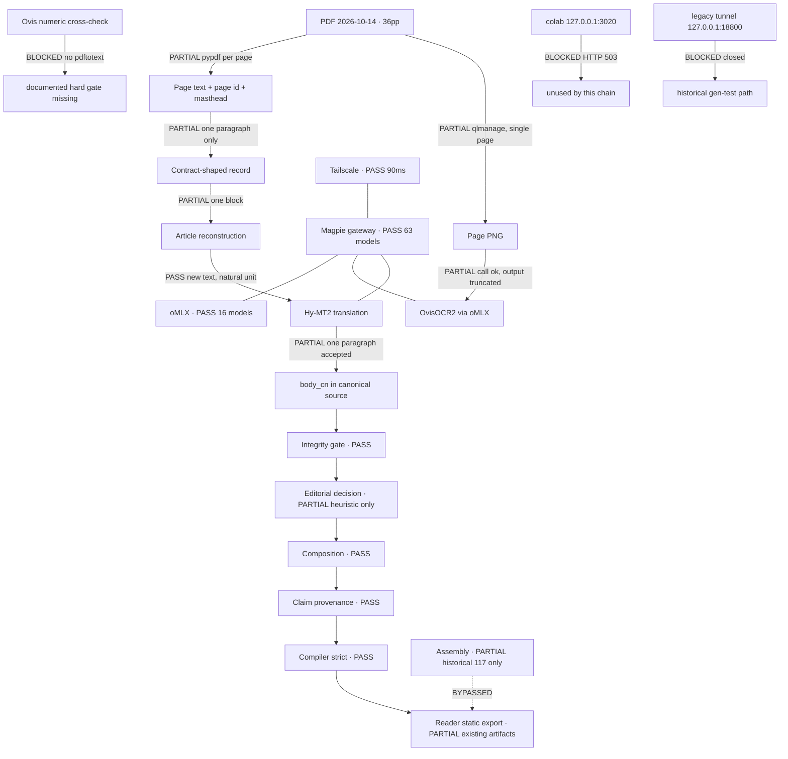

# Pipeline continuity probe — 2026-10-15

One measurement pass. Method: hit each interface with the smallest *real* input that exercises it,
in production order, and record what happened. No repair was attempted, and no hop was re-run for
this report. Temporary workspace `/tmp/probe`; `main`, the `2026-10-12/` production data and the
historical artifacts were left untouched (hashes re-verified after the pass).

Sample: `WSJ Row/RZuKHuduV9Bwqu9z5TqB-WSJNewsPaper-10-14-2026.pdf` — 36 pages, Wednesday, October 14,
2026, Vol. CCLXXXVIII No. 89. Five PDFs were supplied (2025-01-11, 2025-01-16, 2026-01-29,
2026-10-10, 2026-10-14); none of them is the published issue's own edition (2026-10-12, No. 87).

## How to read the statuses

The two axes are reported separately, because a component working is not the same claim as an
interface being continuous:

| Status | Meaning |
|---|---|
| **PASS** | Exercised with an input that is a **complete unit for that interface**, and it worked |
| **PARTIAL** | The component worked on the input used, but the interface's continuity claim is **not established** — input incomplete, output unusable downstream, or scale unproven |
| **BYPASSED** | Upstream did not supply the input; existing intermediate data was used to keep going, and is marked as such |
| **BLOCKED** | A prerequisite (tool, input, service) is missing, so the interface could not be exercised |
| **NOT TESTED** | Not attempted in this pass |

## Connectivity map

**The destination of this probe — a new issue carried through every hop and published — was not
reached.** Each hop below was hit with a minimal input; no single-issue run was performed.

## Results

| # | Interface | Continuity | Component | Minimal evidence |
|---|---|---|---|---|
| 1 | New issue end to end | NOT TESTED | — | No single-issue run; hops were exercised individually |
| 2 | PDF → page text (pypdf) | PARTIAL | works | Page A7 in reading order; one real 251-char paragraph; masthead `THE WALL STREET JOURNAL. Wednesday, October 14, 2026 \| A7`; page id `P2JW287000-4-A00700`; 4 hyphenation artefacts (`weap- ons`); 12 `turn to page A<n>` markers counted across the issue but **no article boundary or continuation was actually resolved** |
| 3 | PDF → page image | PARTIAL | works | `qlmanage -s 2000` rendered a 1.67 MB PNG from one page; macOS-only, one page per invocation, no documented 150 dpi rasteriser in the repo |
| 4 | OCR call (OvisOCR2) | PARTIAL | call works | `omlx/OvisOCR2-MLX-BF16` through the gateway, temperature 0, page PNG as `image_url`; 24.8 s (load 2.64 s, ttft 0.89 s, 249 tok/s, 993 prompt tokens); 3492 chars; `finish_reason=length` at `max_tokens` 900; output is **layout-analysis markdown**, not transcription, so it is not yet shown usable for article reconstruction |
| 5 | OCR numeric cross-check | BLOCKED | — | The archived `ovis-test/COMPARE.md` calls Ovis-vs-`pdftotext` a hard gate after Ovis silently misread two DJIA digits; `pdftotext` is not installed |
| 6 | Multi-page OCR | NOT TESTED | — | By design; the historical rate was 21 s per page |
| 7 | Network path | PASS | works | `tailscale ping dmuss-mac-studio` pong in 90 ms (via 192.168.50.247); every model call below used this path |
| 8 | Gateway | PASS | works | Magpie `http://127.0.0.1:3425/v1` listed 63 models and served every call |
| 9 | Translation model | PASS | works | `omlx/Hy-MT2-30B-A3B-oQ6-MLX` on a real new-issue paragraph: 7.1 s (6.26 s model load, 99 tok/s), correct Simplified Chinese |
| 10 | Repository provider seam | PASS | works | `model_provider.create_provider_for_model('openai-compatible', 'omlx/Hy-MT2-30B-A3B-oQ6-MLX')` + `generate()` → 0.3 s, correct output |
| 11 | Article reconstruction | PARTIAL | works | One paragraph → `build_canonical_source`: 1 block, EN exact match, CN accepted, digest produced. **One block is not a reconstructed article**, let alone a new issue |
| 12 | Integrity gate | PASS | works | The new entry is a complete unit for this gate: `check_article` passed, with one finding (`too_few_paras`) that itself reports the sample is not a full article |
| 13 | Editorial decision | PARTIAL | heuristic only | `evaluate_article_curation` returned `tier=recommended_feature`, `can_enqueue=True`; a heuristic tier is not evidence that **host-agent editorial judgment** works |
| 14 | Composition | PASS | works | `render_article` produced 1222 chars of bilingual HTML with no Studio involvement |
| 15 | Claim provenance | PASS | works | Unreviewed authored intervention blocked → record supplied → strict compile passes → changed payload rejected as `Stale claim evidence`. (Also exercised today at panel scale: 9 pinned versions, 24 records/article) |
| 16 | Compiler | PASS | works | `compile_editorial_artifact(strict=True)` with the record; gate summary `{active:1, host_review:1}` |
| 17 | Reader static export | PARTIAL | works | Isolated copy built `dist/editorial-reader.html` (3.1 MB). Input was **BYPASSED** — the existing 2026-10-12 artifacts, not new-issue output; this does not show the new-issue publication chain is connected |
| 18 | Assembly (historical scripts) | PARTIAL | works | Inside a `/tmp` issue copy, `merge.py` → `assemble.py` both exited 0: 117 entries, `missing trans: []`, wrote `final.json` and `report.md`. This is a **historical-input replay** (BYPASSED), not proof that a new issue's Translation → Assembly is connected |
| 19 | Assembly byte-identity | BYPASSED | — | Assembled `final.json` is not byte-identical to the published one: same 117 ids, 5 entries differ, and only in post-assembly repair fields — `continuation_merged`, `continuation_note`, `turn_to` (E1-005, E2-001, E3-003), `declutter_confirmed`, `declutter_note` (E2-017, E2-033) — plus the `body_en`/`body_cn` those continuation merges extend |
| 20 | colab endpoint `127.0.0.1:3020` | BLOCKED | — | HTTP 503, service unavailable; unused by this chain |
| 21 | Legacy tunnel `127.0.0.1:18800` | BLOCKED | — | Port closed; the historical `gen-test` path cannot run as written. Bypassed in this probe by calling oMLX directly over Tailscale |

Totals: **PASS 7 · PARTIAL 7 · BYPASSED 1 · BLOCKED 3 · NOT TESTED 2**.

## Failure classes

- Network unreachable: none. Tailscale to the model host answers in 90 ms.
- Gateway unavailable: none. Magpie is local; oMLX reports healthy with 16 models and loads on demand.
- Model unavailable: none. Both target models are present (`Hy-MT2-30B-A3B-oQ6-MLX`,
  `OvisOCR2-MLX-BF16`) once they are enabled in Magpie's `omlx` model list; before that they existed
  on the oMLX server but were not routed by the gateway.
- API incompatible: none. One OpenAI-compatible surface serves chat, translation and vision;
  multimodal content parts (`image_url`, `file`) are in the schema, so OCR needs no separate
  protocol. Sampling differences are parameters, not protocol.
- Output-format mismatch: **OvisOCR2**. It answers with its own layout-analysis markdown rather than
  a deterministic transcription, and it truncates at the caller's `max_tokens`.

## Breakpoints and minimal repairs (not performed)

1. **No extractor installed.** `pdftotext`, PyMuPDF, `gs` and `tesseract` are all absent; the
   historical chain started from a `pdftotext` dump that is column-scrambled in places and recovered
   only 26 page ids of a ~36-page issue, while pypdf extracts in reading order and recovers one id
   per page. Repair: keep pypdf (or an equivalent) as an explicit probe-time dependency; do not
   reproduce the scrambled baseline as the reference input.
2. **No rasteriser at scale.** `qlmanage` renders one page at a time and is macOS-only. Repair: pick
   one renderer (PyMuPDF or poppler), fix a dpi, and record it in the pipeline contract.
3. **The numeric cross-check has no implementation.** The documented hard gate cannot run. Repair:
   install poppler, or compare against pypdf text and accept that the check is then no longer
   independent of the extractor.
4. **Ovis output shape and truncation.** Budget `max_tokens` for a whole page and treat the reply as
   analysis to be parsed, not as copy to be trusted.
5. **Assembly is destructive and incomplete.** `assemble.py` overwrites `final.json`, and the
   published file carries repairs it does not perform. Repair: assemble into a candidate file and
   apply continuation/declutter repairs as a separate recorded step.
6. **Two dead endpoints** (`colab` 503, legacy `18800`). Repair: fix or delete the provider entries
   so reachability is not implied.
7. **pypdf font warning.** Some CFF/Type1 fonts want `fontTools`; without it some glyphs may extract
   with the wrong encoding. Repair: add it to the probe environment.
8. **Target-model visibility.** Hy-MT2 and OvisOCR2 are reachable only once enabled in Magpie's
   `omlx` model list, which the repository mirrors through `~/.pi/agent/models.json`. Repair: record
   the intended model set so a fresh machine does not silently lose them.

## What this pass did not establish

- That a new issue can be carried from PDF to published Reader.
- That OCR output is usable for article reconstruction, or that its numbers can be trusted.
- That article boundaries and cross-page continuations can be resolved from page text.
- That host-agent editorial judgment works, as opposed to the curation heuristic returning a tier.
- That translation volume, time and cost are acceptable for a whole issue.
